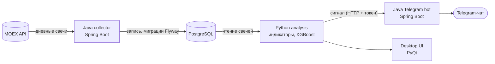
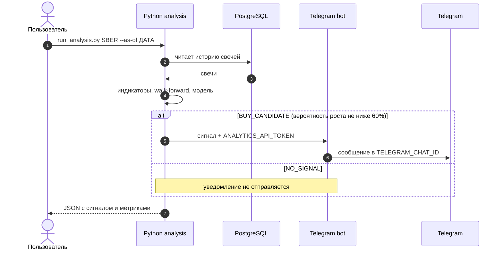

# Trading-Analysis

Учебный проект для сбора и анализа дневных свечей MOEX. Совмещает Java-бэкенд (надёжный сбор данных) и Python-аналитику (статистика, индикаторы, модель). Цель — прокачать инженерные навыки и позже вывести систему на удалённый сервер.

> [!WARNING]
> Статус: в разработке. Аналитика исследовательская и **не является торговой или инвестиционной рекомендацией**. Проект не совершает сделок.

## Что уже работает и что в планах

| Реализовано | В планах |
|---|---|
| Сбор дневных свечей с MOEX и запись в PostgreSQL (Java, Flyway) | Автозапуск анализа после появления закрытой свечи |
| Индикаторы и статистика в Python (общий `AnalysisService`) | Защита от повторной отправки одного и того же сигнала |
| Модель XGBoost с walk-forward проверкой и baseline | Команды Telegram-бота (управление тикерами и настройками) |
| Отправка сигнала в Telegram через защищённый внутренний API | Комиссии и проскальзывание в оценке модели |
| Desktop-приложение на PyQt для просмотра графиков | Раздельные CI-workflow и развёртывание на сервере |

## Архитектура



Каждый компонент решает одну задачу и не дублирует логику других: индикаторы считаются в одном месте и используются и в UI, и при обучении модели.

| Компонент | Технологии | Задача |
|---|---|---|
| **Java collector** | Spring Boot, `MoexDataService`, `DataCollectionScheduler` | Забирает дневные свечи с MOEX, проверяет их и пишет в БД |
| **PostgreSQL** | Flyway (миграции) | Хранит свечи и справочник инструментов |
| **Python analysis** | pandas, statsmodels, scikit-learn, XGBoost | Считает индикаторы и статистику, обучает и оценивает модель |
| **Telegram bot** | Spring Boot | Принимает защищённые сигналы от Python и отправляет их в настроенный чат |
| **Desktop UI** | PyQt | Локальный просмотр графиков, индикаторов и результатов модели |

### Как проходит сигнал



## Структура репозитория

```
.
├── services/java-collector/ # Spring Boot сервис сбора данных
├── telegramBot/             # Spring Boot сервис Telegram-уведомлений
├── python-analytics/        # Python-модуль: индикаторы, модель, UI и CLI анализа
├── docker-compose.yml
└── .github/workflows/
```

## Запуск через Docker Compose

**Требования:**
- Docker Desktop с Docker Compose v2;
- Telegram-бот (токен от BotFather) и идентификатор чата;
- сетевой доступ к `api.telegram.org` с машины, где запускается бот. В некоторых сетях Telegram недоступен без прокси или VPN, проверь это заранее.

Создай `.env` в корне репозитория, скопировав шаблон. В PowerShell:

```powershell
Copy-Item .env.example .env
```

Заполни `.env`:

```dotenv
TELEGRAM_BOT_TOKEN=токен_от_BotFather
TELEGRAM_CHAT_ID=твой_chat_id
ANALYTICS_API_TOKEN=длинная_случайная_строка
```

`ANALYTICS_API_TOKEN` — внутренний секрет для связи Python-анализа с Java-ботом, он должен быть одинаковым для обоих сервисов. Сгенерировать значение можно так:

```bash
openssl rand -hex 32
```

Файл `.env` исключён из Git. Не публикуй его и не отправляй его содержимое в чаты. Если токен бота попал в публичное место, перевыпусти его через BotFather.

Запусти PostgreSQL, Java-сборщик и бота:

```powershell
docker compose up -d postgres collector telegram-bot
```

Проверь, что сервисы запущены:

```bash
docker compose ps
```

Когда в базе накопилось достаточно истории и сборщик записал последнюю **закрытую дневную свечу**, запусти анализ одной бумаги. Дата после `--as-of` должна соответствовать этой свече (формат `ГГГГ-ММ-ДД`):

```powershell
docker compose run --rm analytics python run_analysis.py SBER --as-of 2026-10-29
```

Для всех активных бумаг из таблицы `securities`:

```powershell
docker compose run --rm analytics python run_analysis.py --all-active --as-of 2026-10-29
```

Команда выводит JSON с сигналом и метриками walk-forward. Если модель вернула `BUY_CANDIDATE` (вероятность роста не ниже 60%), бот отправит сообщение в настроенный Telegram-чат. `NO_SIGNAL` не отправляется. Чтобы запустить анализ без уведомления, добавь `--no-notify`.

> [!NOTE]
> Анализ пока запускается **вручную**. Ежедневное расписание и защита от дубликатов ещё не реализованы, поэтому повторный запуск анализа для той же свечи может отправить повторное уведомление.

Логи и остановка сервисов:

```powershell
docker compose logs -f telegram-bot collector
docker compose down
```

Для локального запуска desktop-приложения установи зависимости из [python-analytics/requirements.txt](./python-analytics/requirements.txt), затем из папки `python-analytics` выполни:

```powershell
python src\main.py
```

<!-- TODO: добавить скриншот:  -->

## Как проверяется модель

- **Целевая переменная.** Положительная доходность `close-to-close` через `h = 15` торговых свечей. Комиссии и проскальзывание пока не учитываются.
- **Последние `h` свечей** не имеют известного результата в будущем, поэтому в обучение не попадают. Иначе таргет ошибочно получал бы отрицательную метку.
- **Валидация по времени.** Выборка делится последовательно, а перед тестовым периодом оставляется защитный промежуток (embargo), чтобы исключить утечку через пересекающиеся горизонты.
- **Сравнение с baseline.** Walk-forward сравнивает XGBoost с предсказанием самого частого класса обучающего фолда.
- **Метрики:** accuracy, balanced accuracy, precision, recall и Brier score.

```
время →
Фолд 1:  [==== обучение ====][ embargo ][ тест ]
Фолд 2:  [======= обучение =======][ embargo ][ тест ]
Фолд 3:  [========== обучение ==========][ embargo ][ тест ]

Последние h свечей:  метка неизвестна → в обучение не идут
```

## Принятые решения

- **Одно место для индикаторов.** Их считает общий `AnalysisService`, поэтому UI и обучение модели не расходятся.
- **Walk-forward с embargo** вместо случайного разбиения: так модель оценивается так, как она работала бы во времени, и нет утечки будущих данных.
- **Baseline обязателен.** Без сравнения с простым правилом метрики модели ничего не говорят.
- **Бот не считает индикаторы.** Он только доставляет сигналы, а расчёты остаются в Python.
- **Внутренний API защищён токеном**, а секреты хранятся вне Git.
- **Проверка данных при сборе.** Сборщик проверяет свечи перед записью в базу.

## Известные проблемы

- [x] Баг с отсутствующим будущим периодом исправлен: последние `h` свечей не имеют метки и не участвуют в обучении.
- [x] Индикаторы для UI и модели рассчитываются через общий `AnalysisService`.
- [x] В `requirements.txt` добавлены закреплённые версии `xgboost` и `scikit-learn`.
- [ ] Повторный запуск анализа для той же свечи отправляет повторное уведомление (сигнал не идемпотентен).
- [ ] Расхождение путей `python-analytics` / `services/python-analytics` в CI и Docker workflow.
- [ ] `python-publish.yml` смешивает CI и публикацию пакета, их нужно разделить.

## Дорожная карта

1. **Автоматизировать анализ.** Запускать его после появления закрытой дневной свечи и не отправлять один и тот же сигнал дважды (уникальность по тикеру, правилу и дате свечи).
2. **Развить Telegram-бота.** Добавить команды управления отслеживаемыми тикерами и настройками сигналов.
3. **Улучшить аналитику.** Провести статистическую оценку, добавить комиссии, проскальзывание и дополнительные baseline.
4. **CI/CD.** Отдельные workflow для Java (сборка и тесты), Python (тесты) и Docker.
5. **Развёртывание.** Перенести сервисы на удалённый сервер, desktop-приложение оставить локальным клиентом.

## Ограничения

- Результаты модели — исследовательская аналитика. Проект не даёт торговых рекомендаций и не является системой автоматических сделок.
- Проект использует публичные данные MOEX. Если планируешь публиковать данные или запускать публичный сервис, сначала проверь условия использования данных биржи.